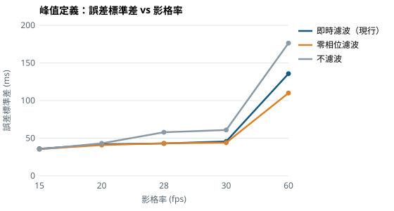
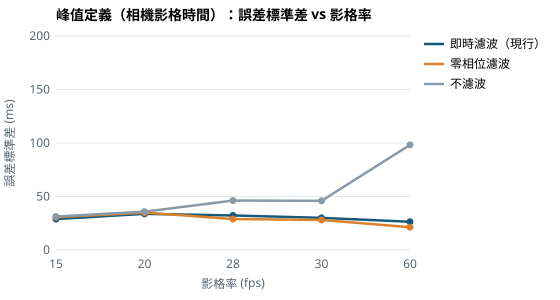

# 模擬實驗：取樣、雜訊與時間抖動對動作時序誤差的影響

## 目的

在拍攝真實慢動作影片之前，先用「已知正確答案」的模擬投籃回答三個問題：

1. 系統的處理流程本身（濾波、樣條插值、事件偵測）會產生多少誤差？
2. 影格率、角度雜訊、時間戳抖動，哪一項影響最大？
3. **起始定義**（手肘開始伸展－膝伸展最快）與**峰值定義**（手肘伸展最快－膝伸展最快）哪一種比較可靠？

## 方法

- **模擬投籃**：膝角由站立 170° 下蹲到 110° 再伸直；肘角由 70° 伸展到 175°。兩者都是平滑的 S 形曲線，曲線參數每球隨機；真實峰值時序差介於 60–200 ms。由於曲線是數學式，真實事件時間可以精確算出，起始時間也用與系統相同的 10°/s 門檻計算。
- **模擬手機取樣**：依影格率取樣，每個樣本加入角度雜訊（模擬關鍵點抖動），時間戳則加上推論延遲的隨機抖動（系統目前用「姿勢結果回傳的時間」當作樣本時間）。
- **與網頁相同的處理**：使用與分析頁同一份程式碼 `專題程式/motion-core.js`，包含開始與結束錄製的觸發條件、即時 Butterworth 濾波、樣條與事件偵測。另外比較兩種替代做法：不濾波，以及錄完後才做的零相位（前後雙向）濾波。
- **誤差**＝系統量到的 Δt－真實 Δt。每個條件 1000 球，亂數固定，結果可以重現。
- 程式：`tools/simulate-timing.cjs`；完整數據：[`simulation/tables.md`](./simulation/tables.md)、[`simulation/results.csv`](./simulation/results.csv)。

| 實驗 | 變因 | 固定條件 |
| --- | --- | --- |
| E0 | 影格率 28、60 fps | 無雜訊、無抖動（檢查流程本身） |
| E1 | 影格率 15、20、28、30、60 fps | 雜訊 2°、抖動 8 ms |
| E2 | 角度雜訊 0、1、2、4° | 28 fps、抖動 8 ms |
| E3 | 時間戳抖動 0、8、20 ms | 28 fps、雜訊 2° |
| E4 | 影格率 15–60 fps，改用相機影格時間 | 雜訊 2°、無抖動 |

## 結果

### 1. 處理流程本身很準（E0）

沒有雜訊與抖動時，所有做法的誤差都在 ±7 ms 以內，標準差 ≤ 4.3 ms。代表濾波、插值與事件偵測的程式邏輯正確。唯一可見的系統性偏差來自即時濾波：28 fps 時，起始定義平均偏 −6.4 ms，峰值定義偏 +2.4 ms。

### 2. 峰值定義明顯比起始定義可靠（E1–E4）

以目前手機的典型條件（28 fps、雜訊 2°、抖動 8 ms、即時濾波）為例：

| 定義 | 誤差 平均 ± 標準差 | 誤差 ≤ 20 ms 的比例 |
| --- | --- | --- |
| 起始定義 | 26.6 ± 52.6 ms | 25% |
| 峰值定義 | 0.2 ± 43.0 ms | 38% |

只要有角度雜訊，起始定義在每一種條件下都偏晚 +12～+122 ms：雜訊會讓「速度低於 10°/s」的位置往後跳。峰值定義的平均誤差大多接近 0，最大為 19 ms，出現在 60 fps 加上時間戳抖動的條件。原因是 10°/s 的門檻遠小於雜訊造成的速度波動，而速度峰值是整段曲線最明顯的特徵。

### 3. 時間戳抖動是最大的誤差來源（E3、E1 對照 E4）

| 抖動 | 峰值定義誤差標準差（28 fps、即時濾波） |
| --- | --- |
| 0 ms | 32.2 ms |
| 8 ms | 43.1 ms |
| 20 ms | 121.1 ms |

用姿勢結果回傳時間當作時間戳時，**提高影格率反而更差**：60 fps 的峰值誤差標準差為 135.7 ms，因為 8 ms 的抖動已經是 60 fps 影格間隔（16.7 ms）的一半。改用相機影格時間（E4）後，影格率提高才真正有幫助：60 fps 時標準差降到 26.4 ms（即時濾波）與 21.3 ms（零相位濾波），誤差 ≤ 20 ms 的比例達 67%。

### 4. 濾波有必要，零相位濾波略好（E1、E2、E4）

有雜訊時，不濾波明顯較差。例如 28 fps、雜訊 2° 時，峰值誤差標準差為 57.9 ms，即時濾波為 43.0 ms；雜訊 4° 時兩者差距更大（105.9 對 63.0 ms）。零相位濾波與即時濾波在低影格率時差不多，在 60 fps 且使用相機影格時間時較好（21.3 對 26.4 ms）。

### 5. 單一球的誤差仍大，需要用多球平均

即使改用相機影格時間並保留濾波（E4），單球峰值誤差的標準差仍約 21–35 ms。系統原本的回饋區間（50–150 ms）只有 100 ms 寬，所以單一球「在區間內／外」的判斷並不可靠。若取 10 球平均，平均值的標準差約為單球的 1/√10（例如 43 ms → 約 14 ms），適合用來看個人的平均節奏與穩定度。

## 選定

1. **時序指標以峰值定義為主要候選**：無系統性偏差、變異較小；與 Templin et al. (2024) 使用的定義一致。最終仍以慢動作實測（[驗證流程](./validation-protocol.md)）確認。
2. **改用相機影格時間作為樣本時間**：模擬顯示這是影響最大的單一改進，列為下一項開發工作。
3. **保留濾波**；零相位濾波在提高影格率後再評估是否採用。
4. **呈現方式改以多球平均與穩定度為主**，不以單球是否落在 50–150 ms 判定對錯（此區間本來就沒有文獻依據，見 [文獻稽核](./shooting-claim-audit.md)）。

## 限制

- 角度曲線、雜訊與抖動都是假設的模型：雜訊假設為各影格獨立的常態分布，實際的關鍵點誤差可能前後相關，也可能有系統性偏差（例如被身體遮擋時）。
- 模擬只涵蓋取樣與處理造成的誤差，不包含 MediaPipe 估計本身的偏差、拍攝角度，或真實球員動作的多樣性。
- 雜訊 2°、抖動 8 ms 是用來比較的代表值，不是實測值。實際數值應從系統匯出的資料（影格間隔、角度訊號）估計，並以慢動作對照的結果為準。
- 因此，這些數字用來**比較做法的優劣**，不能代表系統在真實投籃上的準確度。
