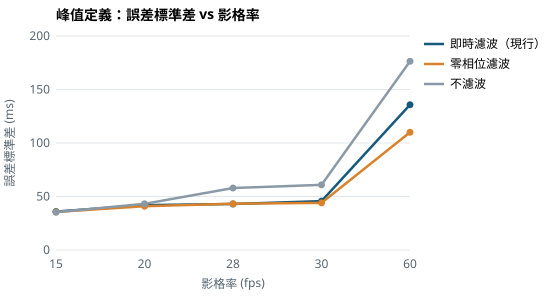
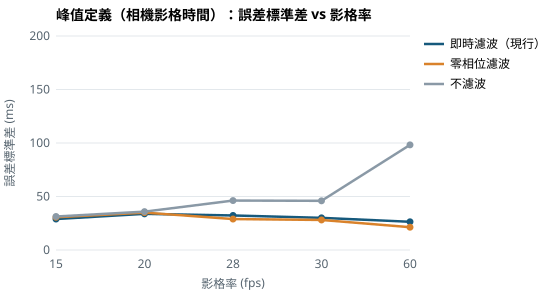

# 模擬實驗：取樣、雜訊與時間抖動對動作時序誤差的影響

## 目的

在拍攝真實慢動作影片之前，先用「已知正確答案」的模擬投籃回答三個問題：

1. 系統的處理流程本身（濾波、樣條插值、事件偵測）會產生多少誤差？
2. 影格率、角度雜訊、時間戳抖動，哪一項影響最大？
3. **起始定義**（手肘開始伸展－膝伸展最快）與**峰值定義**（手肘伸展最快－膝伸展最快）哪一種比較可靠？

## 方法

- **模擬投籃**：膝角由站立 170° 下蹲到 110° 再伸直；肘角由 70° 伸展到 175°。兩者都是平滑的 S 形曲線，曲線參數每球隨機；真實峰值時序差介於 60–200 ms。由於曲線是數學式，真實事件時間可以精確算出，起始時間也用與系統相同的 10°/s 門檻計算。
- **模擬手機取樣**：依影格率取樣，每個樣本加入角度雜訊（模擬關鍵點抖動），時間戳則加上推論延遲的隨機抖動（系統目前用「姿勢結果回傳的時間」當作樣本時間）。
- **與網頁相同的處理**：使用與分析頁同一份程式碼 `專題程式/motion-core.js`，包含開始與結束錄製的觸發條件、即時 Butterworth 濾波、樣條與事件偵測。另外比較兩種替代做法：不濾波，以及錄完後才做的零相位（前後雙向）濾波。
- **誤差**＝系統量到的 Δt－真實 Δt。每個條件 1000 球，亂數固定，結果可以重現。
- 程式：`tools/simulate-timing.cjs`；完整數據：[`simulation/tables.md`](./simulation/tables.md)、[`simulation/results.csv`](./simulation/results.csv)。

| 實驗 | 變因 | 固定條件 |
| --- | --- | --- |
| E0 | 影格率 28、60 fps | 無雜訊、無抖動（檢查流程本身） |
| E1 | 影格率 15、20、28、30、60 fps | 雜訊 2°、抖動 8 ms |
| E2 | 角度雜訊 0、1、2、4° | 28 fps、抖動 8 ms |
| E3 | 時間戳抖動 0、8、20 ms | 28 fps、雜訊 2° |
| E4 | 影格率 15–60 fps，改用相機影格時間 | 雜訊 2°、無抖動 |

## 結果

### 1. 處理流程本身很準（E0）

沒有雜訊與抖動時，所有做法的誤差都在 ±7 ms 以內，標準差 ≤ 4.3 ms。代表濾波、插值與事件偵測的程式邏輯正確。唯一可見的系統性偏差來自即時濾波：28 fps 時，起始定義平均偏 −6.4 ms，峰值定義偏 +2.4 ms。

### 2. 峰值定義明顯比起始定義可靠（E1–E4）

以目前手機的典型條件（28 fps、雜訊 2°、抖動 8 ms、即時濾波）為例：

| 定義 | 誤差 平均 ± 標準差 | 誤差 ≤ 20 ms 的比例 |
| --- | --- | --- |
| 起始定義 | 26.6 ± 52.6 ms | 25% |
| 峰值定義 | 0.2 ± 43.0 ms | 38% |

只要有角度雜訊，起始定義在每一種條件下都偏晚 +12～+122 ms：雜訊會讓「速度低於 10°/s」的位置往後跳。峰值定義的平均誤差大多接近 0，最大為 19 ms，出現在 60 fps 加上時間戳抖動的條件。原因是 10°/s 的門檻遠小於雜訊造成的速度波動，而速度峰值是整段曲線最明顯的特徵。

### 3. 時間戳抖動是最大的誤差來源（E3、E1 對照 E4）

| 抖動 | 峰值定義誤差標準差（28 fps、即時濾波） |
| --- | --- |
| 0 ms | 32.2 ms |
| 8 ms | 43.1 ms |
| 20 ms | 121.1 ms |

用姿勢結果回傳時間當作時間戳時，**提高影格率反而更差**：60 fps 的峰值誤差標準差為 135.7 ms，因為 8 ms 的抖動已經是 60 fps 影格間隔（16.7 ms）的一半。改用相機影格時間（E4）後，影格率提高才真正有幫助：60 fps 時標準差降到 26.4 ms（即時濾波）與 21.3 ms（零相位濾波），誤差 ≤ 20 ms 的比例達 67%。

### 4. 濾波有必要，零相位濾波略好（E1、E2、E4）

有雜訊時，不濾波明顯較差。例如 28 fps、雜訊 2° 時，峰值誤差標準差為 57.9 ms，即時濾波為 43.0 ms；雜訊 4° 時兩者差距更大（105.9 對 63.0 ms）。零相位濾波與即時濾波在低影格率時差不多，在 60 fps 且使用相機影格時間時較好（21.3 對 26.4 ms）。

### 5. 單一球的誤差仍大，需要用多球平均

即使改用相機影格時間並保留濾波（E4），單球峰值誤差的標準差仍約 21–35 ms。系統原本的回饋區間（50–150 ms）只有 100 ms 寬，所以單一球「在區間內／外」的判斷並不可靠。若取 10 球平均，平均值的標準差約為單球的 1/√10（例如 43 ms → 約 14 ms），適合用來看個人的平均節奏與穩定度。

## 選定

1. **時序指標以峰值定義為主要候選**：無系統性偏差、變異較小；與 Templin et al. (2024) 使用的定義一致。最終仍以慢動作實測（[驗證流程](./validation-protocol.md)）確認。
2. **改用相機影格時間作為樣本時間**：模擬顯示這是影響最大的單一改進，列為下一項開發工作。
3. **保留濾波**；零相位濾波在提高影格率後再評估是否採用。
4. **呈現方式改以多球平均與穩定度為主**，不以單球是否落在 50–150 ms 判定對錯（此區間本來就沒有文獻依據，見 [文獻稽核](./shooting-claim-audit.md)）。

## 限制

- 角度曲線、雜訊與抖動都是假設的模型：雜訊假設為各影格獨立的常態分布，實際的關鍵點誤差可能前後相關，也可能有系統性偏差（例如被身體遮擋時）。
- 模擬只涵蓋取樣與處理造成的誤差，不包含 MediaPipe 估計本身的偏差、拍攝角度，或真實球員動作的多樣性。
- 雜訊 2°、抖動 8 ms 是用來比較的代表值，不是實測值。實際數值應從系統匯出的資料（影格間隔、角度訊號）估計，並以慢動作對照的結果為準。
- 因此，這些數字用來**比較做法的優劣**，不能代表系統在真實投籃上的準確度。

## 濾波器比較（2026-11-22）

程式：`tools/simulate-filters.cjs`（`--quick` 為快速版）；完整表格：[`simulation/filters-tables.md`](./simulation/filters-tables.md)、[`simulation/filters-results.csv`](./simulation/filters-results.csv)；測試：`tests/simulate-filters.test.js`。

**方法。**每個條件模擬 1000 球，每種濾波器處理**同樣的雜訊樣本**（配對比較），再經同一個 `detectTiming`，誤差 = 量到的 Δt − 真實 Δt。五個條件：C1 手機實況（28 fps、角度雜訊 2°、時間抖動 8 ms）、C2 相機影格時間（無抖動）、C3 低雜訊 1°、C4 高雜訊 4°、C5 15 fps。候選：不濾波；Butterworth 4 階（即時）截止 4、6、8、10（現行）、12、15 Hz；零相位 Butterworth（事後）6–15 Hz；Savitzky-Golay 5、7 點（事後）；One Euro（2 組參數）；Kalman 等速模型（3 組 q）。圖：`simulation/filters-peak-sd-C1.svg`、`filters-peak-sd-C2.svg`、`filters-onset-sd-C1.svg`、`filters-cutoff-sweep-peak.svg`、`filters-cutoff-sweep-onset.svg`。

**結果（峰值定義，誤差 SD，ms）。**

| 濾波器 | C1 手機實況 | C2 相機影格時間 | C4 高雜訊 |
|---|---|---|---|
| 不濾波 | 56.0 | 48.1 | 110.0 |
| Butterworth 10 Hz（現行） | 46.1 | 30.7 | 60.0 |
| Butterworth 6 Hz | 43.3 | 19.6 | 47.6 |
| Butterworth 4 Hz | 47.3（有效率 88%） | 11.0（有效率 94%） | 48.5（有效率 83%） |
| 零相位 6 Hz | 44.6 | 14.3 | 48.8 |
| Savitzky-Golay 7 點 | 44.9 | 24.0 | 51.6 |
| One Euro（2 Hz，β 0.01） | 31.5，但平均偏差 −21.6 ms | 26.2，平均偏差 −20.6 ms | 41.9，平均偏差 −25.0 ms |
| Kalman（q = 20000） | 36.0 | 29.4 | 53.0 |

**發現。**
1. 濾波有幫助：不濾波的誤差最大，高雜訊下差最多（110 → 約 50–60 ms）。
2. 截止頻率比濾波器種類重要：現行 10 Hz 在三個條件下都不是最好，6 Hz 的峰值誤差較小，起始定義的平均偏差也較接近 0（C1：−8.7 對 +28.4 ms）。4 Hz 太低，約 6–17% 的球算不出時序，且起始偏差變成 −33 ms。
3. 時間戳的來源影響最大：C2（用相機影格時間、無抖動）的誤差約是 C1 的一半或更小（Butterworth 6 Hz：19.6 對 43.3 ms）。要降低誤差，優先改用相機影格時間。
4. One Euro 的 SD 最小，但有 −20 ms 以上的系統性偏差（量到的比真的小），且參數沒有調過；Kalman（q = 20000）是即時濾波中偏差最小且 SD 較低的一個。這兩種都不能因為模擬就直接採用，要用真實資料調參數。
5. 事後濾波（零相位、Savitzky-Golay）沒有明顯贏過即時濾波，不值得為此等整球結束。

**限制。**這是模型：沒有姿態估計偏差、沒有真人，One Euro 與 Kalman 參數只是一般預設值。1000 球下 SD 的標準誤約 2%（約 1 ms），所以相差 3 ms 以內（例如 6 Hz 對 10 Hz 的 C1 差 2.8 ms）只能說「可能較好」。15 fps 時截止頻率超過 7.5 Hz 會被奈奎斯特頻率限制，所以 8、10 Hz 結果相同。

**選定。**目前不改 App 的濾波：沒有真實資料驗證前不改演算法。候選方案是「截止頻率降到 6–8 Hz ＋ 改用相機影格時間」，待 240 fps 慢動作對照取得人工標記後，用同一批資料比較現行與候選。

## 壓力情境（2026-11-22）

程式：`tools/simulate-robustness.cjs`；完整表格：[`simulation/robustness-tables.md`](./simulation/robustness-tables.md)、[`simulation/robustness-results.csv`](./simulation/robustness-results.csv)；圖：`simulation/robustness-peak-sd.svg`、`robustness-onset-sd.svg`；測試：`tests/simulate-robustness.test.js`。

**方法。**同濾波器比較的模擬模型（每條件 1000 球、五種濾波器處理同樣的樣本），加入十種壓力：R0 基準（28 fps、雜訊 2°、抖動 8 ms）；R1、R2 隨機掉影格 5%、15%；R3、R4 快速、慢速投籃者（動作時間 ×0.6、×1.5）；R5、R6 相機視角讓關節角度縮小到 85%、70%（量到的角度向站姿平均壓縮）；R7 相關雜訊（ρ = 0.8，標準差同為 2°）；R8、R9 出手中途追蹤中斷，連續掉 3、6 幀。

**結果（峰值定義，誤差 SD，ms）。**

| 情境 | 不濾波 | 現行 10 Hz | 6 Hz | 零相位 6 Hz | Kalman q=20000 |
|---|---|---|---|---|---|
| R0 基準 | 53.1 | 43.3 | 42.2 | 41.5 | 34.6 |
| R1 掉影格 5% | 51.2 | 49.9 | 47.4 | 46.8 | 36.2 |
| R2 掉影格 15% | 59.2 | 62.1 | 61.8（有效率 96%） | 58.0 | 37.5 |
| R3 快速投籃者 | 27.3 | 27.0 | 30.7（有效率 92%） | 33.3 | 23.0 |
| R4 慢速投籃者 | 107.0 | 74.1 | 61.1 | 62.6 | 60.8 |
| R5 角度縮小 85% | 61.0 | 45.2 | 43.4 | 45.0 | 37.9 |
| R6 角度縮小 70% | 257.0 | 106.2 | 56.0 | 46.6 | 52.3 |
| R7 相關雜訊 | 40.7 | 39.8 | 41.6 | 44.7 | 32.1 |
| R8 連掉 3 幀 | 52.5 | 43.3 | 43.6 | 41.1 | 34.8 |
| R9 連掉 6 幀 | 69.4 | 45.9 | 43.7 | 70.4 | 40.8 |

**發現。**
1. **相機視角是現行做法最大的弱點。**當相機角度使關節角度縮小到 70%，現行 10 Hz 的誤差 SD 從 43 暴增到 106 ms，不濾波更到 257 ms；6 Hz、零相位與 Kalman 都維持在 47–56 ms。原因推測是角度變小後，判斷「手肘伸直」的 155° 門檻與起始速度門檻更晚或更不穩地被碰到，這點在這個模擬裡只做到現象，沒有逐項拆解。結論：相機擺位（要拍到完整的膝與肘角度）對準確度的影響，可能比換濾波器更大，要在真實資料裡測。
2. **慢速投籃者最難。**誤差約是快速投籃者的 2–3 倍（現行 74 對 27 ms）。因為時序量測靠速度門檻，動作越慢、速度越小，越容易被雜訊影響。
3. **掉影格 15% 讓所有 Butterworth 變差**（現行 62 ms），因為濾波器假設影格間隔固定；Kalman 用真實時間間隔計算，幾乎不受影響（37.5 ms）。實際手機約 28 FPS，掉幀率要看真實診斷資料，不能假設。
4. **6 Hz 並非全面較好：**快速投籃者與掉影格時它會讓 8%、4% 的球算不出時序（有效率 92%、96%）。上一份濾波器比較的「6 Hz 較好」要加上這個但書。
5. **Kalman（q = 20000）最穩：**十種情境中有九種誤差最小（唯一例外是角度縮小 70%，零相位 6 Hz 較小），且對掉影格、相關雜訊、連掉幀都沒有明顯變差。但參數仍沒用真實資料調過，且起始定義的偏差約 +20 ms，不能直接採用。
6. 連掉 6 幀後，所有方法的峰值平均偏差都變成約 −12 至 −34 ms（量到的比真的小），代表追蹤中斷應該標記為低品質，不應該硬算。

**限制。**同前：模型、沒有真人、參數未調。R6 的原因只是推測。每格 1000 球，SD 的標準誤約 2%。

**選定。**目前仍不改 App 的濾波與門檻。下一步用真實資料驗證兩件事：①相機擺位對有效率與誤差的影響；②Kalman 與 6 Hz 是否在真實慢動作對照裡也較好。
